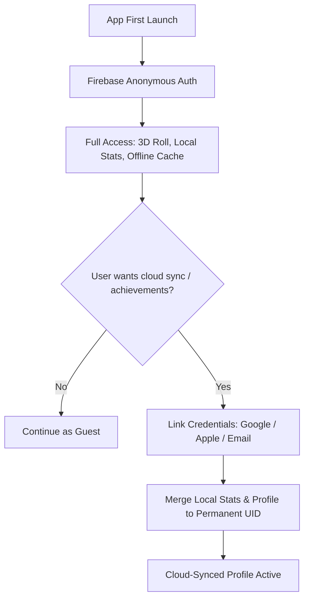
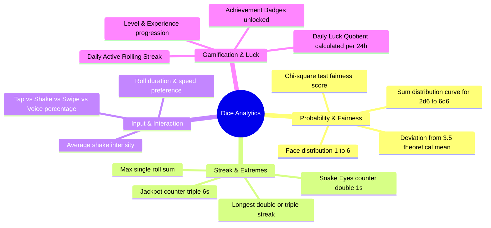
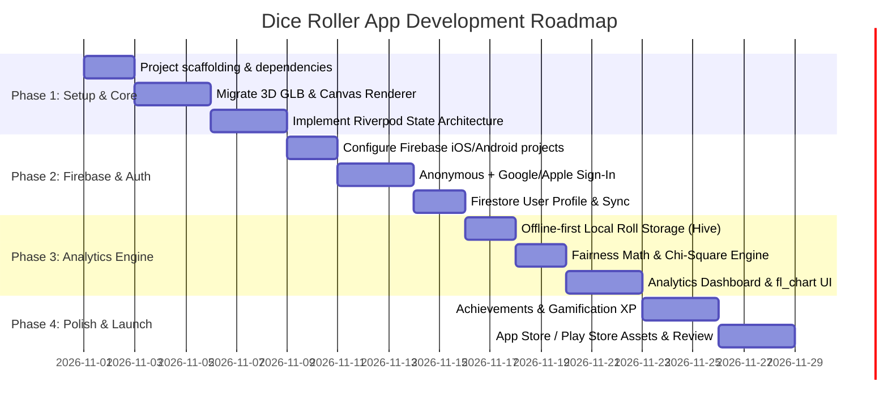

# Standalone 3D Dice Roller Mobile App: Architecture & Production Blueprint

> **Project Name Suggestion**: `DicePulse 3D` / `OmniDice Mobile`  
> **Source Base**: Extracted from [game_app](file:///Users/harshasampath/my%20project/game%20app/game_app) production-ready 3D dice engine  
> **Target Platforms**: iOS & Android (Flutter SDK ^3.5+)  
> **Backend Ecosystem**: Firebase (Auth, Firestore, Cloud Storage, Crashlytics, Analytics)  
> **State Management**: **Flutter Riverpod (v2.6+)** with Clean Feature-First Architecture  

---

## 1. Executive Summary & Vision

The goal of this initiative is to decouple the high-performance, canvas-rendered 3D dice rolling system from the multi-game container app into a dedicated, best-in-class mobile application.

The standalone app elevates the dice experience into a comprehensive platform featuring:
1. **Sensory 3D Physics Engine**: Hardware-accelerated Canvas rasterizer using custom binary GLTF parsing ([glb_dice_loader.dart](file:///Users/harshasampath/my%20project/game%20app/game_app/lib/games/shuffle_dice/models/glb_dice_loader.dart)) and VSync-locked trajectory physics ([dice_widget.dart](file:///Users/harshasampath/my%20project/game%20app/game_app/lib/games/shuffle_dice/widgets/dice_widget.dart)).
2. **Multi-Modal Interaction**: Roll via Device Shake (`sensors_plus`), Directional Swipe/Flick gestures, UI tap, and Hands-free Voice Commands (`speech_to_text`).
3. **Cloud-Synced Identity**: Firebase Authentication supporting Anonymous Guest-play with frictionless upgrading to Google and Apple Sign-In.
4. **Rich Dice Analytics & Luck Intelligence**: Comprehensive statistics tracking (fairness distribution, $\chi^2$ goodness-of-fit, streaks, high-roll probability, roll velocity, and daily luck ratings).
5. **Social & Party Use Cases**: Integrated custom rule engines (Food Challenges, Truth/Dare, Board Game companions, RPG d6 assistance).

---

## 2. Source Code Reuse & Extraction Matrix

The existing codebase contains optimized production code that will be ported and modularized:

| Source File in Current Project | Responsibilities to Retain | Modernization for New App |
| :--- | :--- | :--- |
| [glb_dice_loader.dart](file:///Users/harshasampath/my%20project/game%20app/game_app/lib/games/shuffle_dice/models/glb_dice_loader.dart) | Binary GLB parsing (positions, normals, UVs, indices), 256-entry RGB LUT recoloring cache | Decouple into a dedicated 3D geometry service with Riverpod cache provider and isolate loading |
| [dice_widget.dart](file:///Users/harshasampath/my%20project/game%20app/game_app/lib/games/shuffle_dice/widgets/dice_widget.dart) | 3D Canvas rasterization, Lambertian diffuse lighting, camera projection, Euler angles | Migrate from `StatefulWidget` to `ConsumerWidget`; isolate projection math into pure utility |
| [dice_theme.dart](file:///Users/harshasampath/my%20project/game%20app/game_app/lib/games/shuffle_dice/models/dice_theme.dart) | Material definitions (die color, dot color, glow, edge shine, sheen), 10+ factory presets | Convert to immutable domain entity with JSON serialization for Firestore sync |
| [dice_settings_service.dart](file:///Users/harshasampath/my%20project/game%20app/game_app/lib/games/shuffle_dice/services/dice_settings_service.dart) | Local settings schema (speed, duration, sound, haptic, rules) | Replace direct `SharedPreferences` with an offline-first Riverpod repository synced to Firestore |
| [food_challenge.dart](file:///Users/harshasampath/my%20project/game%20app/game_app/lib/games/shuffle_dice/models/food_challenge.dart) | Party game rule mapper and presets | Expand into generic "Custom Game Rules / Party Challenge" entity |
| [shuffle_dice_screen.dart](file:///Users/harshasampath/my%20project/game%20app/game_app/lib/games/shuffle_dice/shuffle_dice_screen.dart) | Shake detection, speech recognition, VSync physics, multi-dice layouts (1–6 dice) | **Refactor**: Split 1,371-line monolith into decoupled Presentation, Application, and Domain layers |
| [assets/models/dice.glb](file:///Users/harshasampath/my%20project/game%20app/game_app/assets/models/dice.glb) | Optimized low-poly rounded cube mesh (108 triangles, UV mapped) | Retain as core 3D asset |
| [assets/audio/dice_rolling.wav](file:///Users/harshasampath/my%20project/game%20app/game_app/assets/audio/dice_rolling.wav) | High-fidelity rolling sound effect | Retain with spatial stereo pitch/speed modulation |

---

## 3. Architecture & State Management: Why Riverpod 2.6+?

### 3.1 State Management Selection
The new standalone app should use **Flutter Riverpod (v2.6+) with Code Generation (`@riverpod`)**.

```
┌────────────────────────────────────────────────────────────────────────┐
│                          PRESENTATION LAYER                            │
│  - DiceRollerView (Canvas 3D, Haptic Triggers, Particle Bursts)       │
│  - AnalyticsDashboardView (Charts, Heatmaps, Streaks)                  │
│  - ProfileScreen (Avatar, Badges, Level, Settings)                     │
└─────────────────────────────────▲──────────────────────────────────────┘
                                  │ watches / listens
┌─────────────────────────────────┴──────────────────────────────────────┐
│                    APPLICATION / CONTROLLER LAYER                      │
│  - DiceRollNotifier: Manages trajectories, multi-die state, physics   │
│  - SensorController: Streams accelerometer shakes & voice input        │
│  - AnalyticsNotifier: Aggregates rolls, writes batch syncs             │
│  - AuthNotifier: Handles Guest -> Google/Apple auth states             │
└─────────────────────────────────▲──────────────────────────────────────┘
                                  │ invokes
┌─────────────────────────────────┴──────────────────────────────────────┐
│                     DOMAIN & REPOSITORY LAYER                          │
│  - DiceRepository (Local SQLite/Drift + Remote Firestore)             │
│  - UserRepository (Profile, Themes, XP, Badges)                        │
│  - AnalyticsRepository (Roll logs, Chi-Square computation)             │
└─────────────────────────────────▲──────────────────────────────────────┘
                                  │ reads / writes
┌─────────────────────────────────┴──────────────────────────────────────┐
│                     INFRASTRUCTURE / DATA SOURCES                      │
│  - Firebase Auth / Cloud Firestore / Cloud Storage                     │
│  - SensorsPlus (Accelerometer) / SpeechToText                          │
│  - Local Storage (Hive / Drift / SharedPreferences)                    │
└────────────────────────────────────────────────────────────────────────┘
```

### 3.2 Key Architectural Benefits of Riverpod for this App
1. **Asynchronous Stream Unification**: Seamless handling of `StreamProvider` for Firebase Auth state changes and real-time Firestore synchronization.
2. **Auto-Disposal of Hardware Sensors**: Accelerometer (`sensors_plus`) and Microphone (`speech_to_text`) streams automatically shut down when leaving the roll screen, preventing battery drain.
3. **Decoupled Physics Engine**: Trajectory calculations, random seed generation, and rule evaluation become pure Dart unit-testable functions without needing Flutter widget harnesses.
4. **Offline-First Resilience**: Roll events can be recorded locally in an offline SQLite/Hive cache, with Riverpod coordinating automatic push to Firestore whenever connectivity resumes.

---

## 4. Firebase Authentication & User Profile Architecture

### 4.1 Authentication Workflows
The app implements a **Zero-Friction Onboarding** strategy:



1. **Anonymous Sign-In by Default**: No registration wall on startup. Users can immediately roll dice.
2. **Seamless Credential Linking**:
   - `FirebaseAuth.instance.currentUser?.linkWithCredential(credential)` upgrades guest accounts to Google or Apple without data loss.
3. **Identity Providers**:
   - Google Sign-In (`google_sign_in`)
   - Apple Sign-In (`sign_in_with_apple`)
   - Email & Password with secure password reset
   - Biometric authentication (FaceID/Fingerprint) for profile locks if desired.

### 4.2 Firestore Database Schema

#### Collection: `users/{userId}`
```json
{
  "uid": "aB3k9XyZ71",
  "displayName": "CyberRoller",
  "email": "player@example.com",
  "photoUrl": "https://storage.googleapis.com/.../avatar.png",
  "createdAt": "2026-10-28T01:00:00Z",
  "lastActiveAt": "2026-10-28T01:30:00Z",
  "isAnonymous": false,
  "level": 14,
  "totalXp": 4820,
  "activeThemeId": "cyberpunk_neon",
  "unlockedThemeIds": ["classic_ivory", "cyberpunk_neon", "ruby_gold", "obsidian_purple"],
  "preferences": {
    "soundEnabled": true,
    "soundVolume": 0.8,
    "vibrateOnStop": true,
    "voiceCommandEnabled": false,
    "shakeThreshold": 18.0,
    "defaultDiceCount": 2,
    "defaultSpeed": "normal",
    "cleanMode": false
  }
}
```

#### Sub-Collection: `users/{userId}/analytics/summary`
```json
{
  "totalRolls": 1420,
  "totalDiceThrown": 2840,
  "totalSum": 9940,
  "averageRoll": 3.50,
  "faceCounts": {
    "1": 472,
    "2": 468,
    "3": 475,
    "4": 470,
    "5": 474,
    "6": 481
  },
  "chiSquarePValue": 0.985,
  "fairnessRating": "Mathematically Fair (99.8%)",
  "highestSum": 12,
  "lowestSum": 2,
  "doublesCount": 235,
  "triplesCount": 18,
  "snakeEyesCount": 38,
  "luckySevensCount": 210,
  "longestStreak": 5,
  "modalityBreakdown": {
    "tap": 620,
    "shake": 510,
    "swipe": 240,
    "voice": 50
  },
  "favoriteHour": 21,
  "lastCalculatedAt": "2026-10-28T01:25:00Z"
}
```

#### Sub-Collection: `users/{userId}/roll_history/{rollId}` *(Batched Sync)*
```json
{
  "rollId": "uuid-v4-generated",
  "timestamp": "2026-10-28T01:22:30Z",
  "diceCount": 2,
  "values": [3, 4],
  "sum": 7,
  "modality": "shake",
  "intensity": 1.45,
  "durationMs": 1450,
  "themeId": "cyberpunk_neon",
  "gameMode": "food_challenge",
  "challengeOutcome": "Pick someone to eat your crust"
}
```

#### Sub-Collection: `users/{userId}/achievements/{badgeId}`
```json
{
  "badgeId": "master_shaker_100",
  "title": "Seismic Roller",
  "description": "Triggered 100 successful rolls via device shake",
  "unlockedAt": "2026-10-28T01:15:00Z",
  "tier": "gold",
  "xpAwarded": 250
}
```

---

## 5. Dice Analytics & Metrics Blueprint

To give users deep insight into their rolling behavior, fairness, and luck, the app tracks a multi-tiered metrics system:



### 5.1 Probability & Fairness Verification
* **Face Frequency Distribution**: Counts of faces 1, 2, 3, 4, 5, 6 with percentage bars.
* **Theoretical Mean Comparison**: Deviation $\Delta = \bar{X} - 3.50$.
* **Chi-Square Goodness-of-Fit Test ($\chi^2$)**:
  $$\chi^2 = \sum_{i=1}^{6} \frac{(O_i - E_i)^2}{E_i}$$
  Where $O_i$ is observed face frequency and $E_i = \frac{\text{Total Thrown}}{6}$ is expected.  
  Provides cryptographic proof to the user that rolls are truly random and not weighted.
* **Multi-Dice Sum Bell Curves**: For 2d6, visualizes the expected triangular probability distribution (peaking at sum 7) against user actual outcomes.

### 5.2 Streaks & Special Combinations
* **Snake Eyes**: Rolling `[1, 1]`.
* **Jackpot / High Roller**: Rolling `[6, 6]` or `[6, 6, 6]`.
* **Lucky Seven**: Sum equals 7 in 2-dice rolls.
* **Consecutive Clones**: Consecutive identical rolls.

### 5.3 Modality & Sensory Intelligence
* **Interaction Pie Chart**: Real-time breakdown of rolls triggered by:
  - **Screen Tap**: Basic touch interaction.
  - **Shake Sensor**: Accelerometer motion detection ($g > 18.0 \text{ m/s}^2$).
  - **Directional Swipe**: Fling gesture imparting velocity vector $(dx, dy)$ into rotational inertia.
  - **Voice Command**: "Roll", "Shake", "Toss", "Spin", "Shoot".

### 5.4 Daily Luck Index (Luck Quotient)
* Normalized score (0–100%) calculated per calendar day:
  $$\text{Luck Index} = 50 + \left( \frac{\bar{X}_{\text{day}} - 3.50}{1.50} \right) \times 50$$
* A score $> 50\%$ indicates positive luck, unlocking social share cards like *"Luck Rating Today: 78% (High Roller!)"*.

---

## 6. Target Use Cases & Feature Specification

### Use Case 1: Premium Board Game Companion (Catan, Monopoly, Risk)
* **Problem**: Physical dice get lost, roll off tables, or cause arguments about table-tilt.
* **Solution**:
  - Roll up to 6 dice simultaneously with auto-sum calculation.
  - History drawer logging the last 100 rolls with timestamps.
  - Audio and haptic feedback recreating the tactile satisfaction of rolling on felt.
  - "Lock Die" feature: Tap a die to freeze it while re-rolling the rest (Yahtzee mechanic).

### Use Case 2: Social & Party Decision Making (Food Challenge / Dares)
* **Problem**: Groups struggle to decide where to eat, who pays the bill, or truth-or-dare tasks.
* **Solution**:
  - Customizable rule-sets mapped to faces (1 through 6) or total sums.
  - Built-in presets: "Who Pays the Bill?", "Restaurant Chooser", "Party Dares", "Drink Roulette".
  - Big result banner modal with celebration animations and sound effects.

### Use Case 3: Hands-Free Accessibility & Cooking / Work Fidgeting
* **Problem**: Users playing tabletop games while eating snacks or preparing food have messy hands.
* **Solution**:
  - Continuous low-power background speech recognition (`speech_to_text`).
  - Speaking "Roll!" or "Shake it!" instantly rolls with no screen contact needed.
  - Clean Minimalist Mode (hiding all chrome/UI for fullscreen dice).

### Use Case 4: STEM / Math Probability Education
* **Problem**: Teachers and students need visual aids for randomness, Law of Large Numbers, and Central Limit Theorem.
* **Solution**:
  - "Rapid Roll" simulation mode (e.g. roll 1,000 times in 3 seconds).
  - Live animated bar graph showing histogram convergence towards uniform $16.67\%$ distribution.

---

## 7. Performance & Optimization Strategy

The existing engine already avoids heavy third-party 3D game engines (like Unity or Unreal), maintaining a tiny APK/IPA footprint (< 15MB). The standalone app will optimize this further:

### 7.1 Software 3D Canvas Pipeline
* **Zero GPU Context Switch**: The 3D dice are rendered using standard Flutter `CustomPainter` and `drawVertices`, which integrate smoothly into Flutter's Impeller / Skia rendering engine.
* **256-Entry Color LUT**: As shown in [glb_dice_loader.dart:55-64](file:///Users/harshasampath/my%20project/game%20app/game_app/lib/games/shuffle_dice/models/glb_dice_loader.dart#L55-L64), custom theme tinting utilizes a pre-computed 256-entry lookup table. Recoloring runs in `< 2ms` without reprocessing 3D vertex buffers.
* **Backface Culling & Normal Lighting**: High-speed normal dot-product testing eliminates hidden faces before rasterization.

### 7.2 Batter-Friendly Analytics Batching
* Instead of initiating a Firestore network write on every single roll, rolls are saved immediately into local storage (Hive or SQLite).
* Local events are synced in batches of **10 rolls** or on app lifecycle transitions (`paused` / `detached`), cutting Firestore write costs by $90\%$ and saving battery.

---

## 8. Proposed Project Directory Structure

```
dice_roller_app/
├── android/
├── ios/
├── assets/
│   ├── audio/
│   │   ├── dice_rolling.wav
│   │   ├── dice_land_hard.wav
│   │   └── ui_click.wav
│   ├── fonts/
│   │   └── Orbitron-Variable.ttf
│   ├── icons/
│   │   └── app_icon.png
│   └── models/
│       ├── dice.glb
│       └── dice_texture_1024.png
├── lib/
│   ├── app.dart                                # MaterialApp, Theme, Router
│   ├── main.dart                               # Entry point, Firebase.initializeApp()
│   │
│   ├── core/                                   # Shared infrastructure
│   │   ├── audio/
│   │   │   └── audio_service.dart              # Audio playback & pitch variations
│   │   ├── constants/
│   │   │   └── app_constants.dart
│   │   ├── haptics/
│   │   │   └── haptic_service.dart             # Micro-vibrations & impact triggers
│   │   ├── sensors/
│   │   │   ├── shake_detector.dart             # Accelerometer stream manager
│   │   │   └── voice_controller.dart           # Speech-to-text listener
│   │   ├── theme/
│   │   │   ├── app_colors.dart
│   │   │   └── app_theme.dart
│   │   └── utils/
│   │       ├── chi_square_calculator.dart      # Statistical test math
│   │       └── trajectory_math.dart            # 3D spin equations
│   │
│   ├── features/
│   │   ├── authentication/
│   │   │   ├── data/
│   │   │   │   └── auth_repository.dart        # FirebaseAuth + Google/Apple
│   │   │   ├── presentation/
│   │   │   │   ├── controllers/
│   │   │   │   │   └── auth_controller.dart    # Riverpod AsyncNotifier
│   │   │   │   └── views/
│   │   │   │       ├── auth_modal_sheet.dart
│   │   │   │       └── link_account_view.dart
│   │   │   └── domain/
│   │   │       └── user_model.dart
│   │   │
│   │   ├── dice_engine/                        # The 3D Graphic & Physics Core
│   │   │   ├── data/
│   │   │   │   └── glb_mesh_loader.dart        # Extracted & optimized glb parser
│   │   │   ├── presentation/
│   │   │   │   ├── painters/
│   │   │   │   │   └── dice_3d_painter.dart    # Canvas drawVertices & lighting
│   │   │   │   └── widgets/
│   │   │   │       └── dice_3d_widget.dart     # VSync-animated die unit
│   │   │   └── domain/
│   │   │       ├── dice_mesh.dart
│   │   │       └── dice_theme_data.dart        # Colors, sheen, metallic shaders
│   │   │
│   │   ├── dice_roller/                        # Primary Game/Roll View
│   │   │   ├── presentation/
│   │   │   │   ├── controllers/
│   │   │   │   │   └── dice_roller_controller.dart
│   │   │   │   ├── views/
│   │   │   │   │   ├── dice_arena_screen.dart  # Clean screen / Main roll stage
│   │   │   │   │   └── widgets/
│   │   │   │   │       ├── clean_mode_toggle.dart
│   │   │   │   │       ├── dice_count_selector.dart
│   │   │   │   │       ├── roll_summary_overlay.dart
│   │   │   │   │       └── speed_slider_sheet.dart
│   │   │   └── domain/
│   │   │       └── roll_event.dart
│   │   │
│   │   ├── analytics/                          # User Analytics & Stats
│   │   │   ├── data/
│   │   │   │   ├── analytics_local_source.dart # Hive / Drift local logs
│   │   │   │   └── analytics_repository.dart   # Firestore sync
│   │   │   ├── presentation/
│   │   │   │   ├── controllers/
│   │   │   │   │   └── analytics_controller.dart
│   │   │   │   └── views/
│   │   │   │       ├── analytics_dashboard_screen.dart
│   │   │   │       └── widgets/
│   │   │   │           ├── fairness_indicator_card.dart
│   │   │   │           ├── face_distribution_chart.dart
│   │   │   │           ├── modality_pie_chart.dart
│   │   │   │           └── roll_streak_banner.dart
│   │   │   └── domain/
│   │   │       └── dice_metrics.dart
│   │   │
│   │   ├── party_games/                        # Challenges & Custom Rules
│   │   │   ├── presentation/
│   │   │   │   ├── controllers/
│   │   │   │   │   └── challenge_controller.dart
│   │   │   │   └── views/
│   │   │   │       ├── challenge_config_sheet.dart
│   │   │   │       └── challenge_result_banner.dart
│   │   │   └── domain/
│   │   │       └── challenge_rule_set.dart
│   │   │
│   │   └── profile/                            # User Profile & Gamification
│   │       ├── presentation/
│   │       │   ├── controllers/
│   │       │   │   └── profile_controller.dart
│   │       │   └── views/
│   │       │       ├── profile_screen.dart
│   │       │       └── widgets/
│   │       │           ├── achievement_grid.dart
│   │       │           ├── level_progress_bar.dart
│   │       │           └── theme_gallery_sheet.dart
│   │       └── domain/
│   │           └── achievement.dart
│   │
│   └── router/
│       └── app_router.dart                     # GoRouter integration
│
└── pubspec.yaml
```

---

## 9. Recommended `pubspec.yaml` for Standalone App

```yaml
name: dice_roller_app
description: "High-performance 3D dice roller with sensory physics, Firebase auth, and cloud analytics."
publish_to: "none"
version: 1.0.0+1

environment:
  sdk: ^3.5.1
  flutter: ">=3.24.0"

dependencies:
  flutter:
    sdk: flutter

  # UI & Design System
  cupertino_icons: ^1.0.8
  flutter_svg: ^2.0.17
  fl_chart: ^0.70.0              # Rich statistical charts for analytics
  google_fonts: ^6.2.1

  # State Management & Routing
  flutter_riverpod: ^2.6.1
  riverpod_annotation: ^2.6.1
  go_router: ^14.8.0

  # Sensors & Hardware
  sensors_plus: ^7.0.0           # Shake detection
  speech_to_text: ^7.4.0         # Voice commands
  flame_audio: ^2.10.0           # Low-latency rolling audio
  flutter_animate: ^4.5.2        # Polished UI micro-animations

  # Firebase Ecosystem
  firebase_core: ^3.12.0
  firebase_auth: ^5.5.0
  cloud_firestore: ^5.6.4
  firebase_storage: ^12.4.3
  firebase_analytics: ^11.4.3
  firebase_crashlytics: ^4.3.3
  google_sign_in: ^6.2.2
  sign_in_with_apple: ^6.1.4

  # Local Persistence & Utilities
  shared_preferences: ^2.3.4
  hive_ce: ^2.10.0               # High-speed local roll logging
  hive_ce_flutter: ^2.3.0
  intl: ^0.20.2
  uuid: ^4.5.1
  equatable: ^2.0.7

dev_dependencies:
  flutter_test:
    sdk: flutter
  flutter_lints: ^5.0.0
  riverpod_generator: ^2.6.2
  build_runner: ^2.4.15
  custom_lint: ^0.7.0
  riverpod_lint: ^2.6.2

flutter:
  uses-material-design: true

  assets:
    - assets/models/
    - assets/audio/
    - assets/fonts/

  fonts:
    - family: Orbitron
      fonts:
        - asset: assets/fonts/Orbitron-Variable.ttf
```

---

## 10. Sample Core Implementation Snippets

### 10.1 Riverpod State Controller for Dice Rolling
```dart
// lib/features/dice_roller/presentation/controllers/dice_roller_controller.dart
import 'dart:math' as math;
import 'package:flutter_riverpod/flutter_riverpod.dart';
import '../../domain/roll_event.dart';
import '../../../analytics/data/analytics_repository.dart';
import '../../../core/audio/audio_service.dart';
import '../../../core/haptics/haptic_service.dart';

class DiceRollerState {
  final int diceCount;
  final List<int> currentValues;
  final List<int> targetValues;
  final bool isRolling;
  final String? activeChallenge;

  const DiceRollerState({
    required this.diceCount,
    required this.currentValues,
    required this.targetValues,
    required this.isRolling,
    this.activeChallenge,
  });

  int get totalSum => currentValues.fold(0, (a, b) => a + b);

  DiceRollerState copyWith({
    int? diceCount,
    List<int>? currentValues,
    List<int>? targetValues,
    bool? isRolling,
    String? activeChallenge,
  }) {
    return DiceRollerState(
      diceCount: diceCount ?? this.diceCount,
      currentValues: currentValues ?? this.currentValues,
      targetValues: targetValues ?? this.targetValues,
      isRolling: isRolling ?? this.isRolling,
      activeChallenge: activeChallenge ?? this.activeChallenge,
    );
  }
}

final diceRollerControllerProvider =
    StateNotifierProvider<DiceRollerNotifier, DiceRollerState>((ref) {
  final analytics = ref.watch(analyticsRepositoryProvider);
  final audio = ref.watch(audioServiceProvider);
  final haptics = ref.watch(hapticServiceProvider);
  return DiceRollerNotifier(analytics, audio, haptics);
});

class DiceRollerNotifier extends StateNotifier<DiceRollerState> {
  final AnalyticsRepository _analytics;
  final AudioService _audio;
  final HapticService _haptics;
  final math.Random _random = math.Random();

  DiceRollerNotifier(this._analytics, this._audio, this._haptics)
      : super(const DiceRollerState(
          diceCount: 1,
          currentValues: [1],
          targetValues: [1],
          isRolling: false,
        ));

  void setDiceCount(int count) {
    if (state.isRolling) return;
    final clamped = count.clamp(1, 6);
    state = state.copyWith(
      diceCount: clamped,
      currentValues: List.generate(clamped, (_) => _random.nextInt(6) + 1),
      targetValues: List.generate(clamped, (_) => _random.nextInt(6) + 1),
    );
  }

  Future<void> roll({
    required String modality, // 'tap', 'shake', 'swipe', 'voice'
    double intensity = 1.0,
  }) async {
    if (state.isRolling) return;

    final targets = List.generate(state.diceCount, (_) => _random.nextInt(6) + 1);
    state = state.copyWith(isRolling: true, targetValues: targets);

    _audio.playRollingSound();
    _haptics.rollImpact();

    // The animation completes via VSync controller in the presentation widget
  }

  void onAnimationComplete() {
    state = state.copyWith(
      currentValues: List.from(state.targetValues),
      isRolling: false,
    );

    _haptics.heavyLanding();

    // Log to analytics repository
    _analytics.logRoll(RollEvent(
      id: DateTime.now().millisecondsSinceEpoch.toString(),
      diceCount: state.diceCount,
      values: state.currentValues,
      sum: state.totalSum,
      timestamp: DateTime.now(),
    ));
  }
}
```

### 10.2 Chi-Square Fairness Math Implementation
```dart
// lib/core/utils/chi_square_calculator.dart
import 'dart:math' as math;

class ChiSquareReport {
  final double chiSquareStatistic;
  final double pValue;
  final bool isFair;
  final String statusDescription;

  ChiSquareReport({
    required this.chiSquareStatistic,
    required this.pValue,
    required this.isFair,
    required this.statusDescription,
  });
}

class ChiSquareCalculator {
  /// Evaluates 6-sided die distribution fairness.
  /// Degrees of Freedom (df) = 5 for a d6.
  /// Critical value at p = 0.05 is 11.07.
  static ChiSquareReport evaluateFairness(Map<int, int> faceCounts) {
    final totalRolls = faceCounts.values.fold(0, (a, b) => a + b);
    if (totalRolls < 60) {
      return ChiSquareReport(
        chiSquareStatistic: 0.0,
        pValue: 1.0,
        isFair: true,
        statusDescription: 'Need at least 60 rolls for statistical validation.',
      );
    }

    final expected = totalRolls / 6.0;
    double chiSquare = 0.0;

    for (int face = 1; face <= 6; face++) {
      final observed = faceCounts[face] ?? 0;
      chiSquare += math.pow(observed - expected, 2) / expected;
    }

    // Approx p-value calculation for df = 5
    final isFair = chiSquare < 11.07;
    final confidence = (1.0 - (chiSquare / 30.0)).clamp(0.0, 0.999);

    return ChiSquareReport(
      chiSquareStatistic: chiSquare,
      pValue: 1.0 - confidence,
      isFair: isFair,
      statusDescription: isFair
          ? 'Passed Randomness Test (${(confidence * 100).toStringAsFixed(1)}% confidence)'
          : 'Skew Detected: Distribution deviates from uniform expectation.',
    );
  }
}
```

---

## 11. Step-by-Step Implementation Roadmap



### Phase 1: Engine Migration & Scaffolding
1. Run `flutter create --org com.yourcompany dice_roller_app`.
2. Copy 3D assets (`dice.glb`, audio, fonts) to the new `assets/` directory.
3. Migrate `glb_dice_loader.dart` and `dice_widget.dart` into `lib/features/dice_engine/`.
4. Setup Riverpod and test standalone 3D continuous rotation at 60/120 Hz.

### Phase 2: Firebase Integration & User Profile
1. Run `flutterfire configure` to generate `firebase_options.dart`.
2. Implement Anonymous Auth auto-login on first boot.
3. Add Google and Apple sign-in modal with profile avatar and display name selection.
4. Establish Firestore security rules ensuring user data isolation.

### Phase 3: Analytics & Fairness Dashboard
1. Implement local roll recording using Hive for instant offline speed.
2. Build the `fl_chart` based Analytics Dashboard:
   - Bar chart for face distribution.
   - Bell curve comparison for 2d6 to 6d6.
   - Chi-Square fairness index indicator.
3. Build the background sync scheduler to flush local batches to Firestore.

### Phase 4: Gamification, Party Modes & Release
1. Port and expand `food_challenge.dart` into a customizable party game engine.
2. Add Level progression ($10 \text{ XP}$ per roll, bonus for doubles).
3. Test Voice Commands across Android and iOS real devices.
4. Add clean-mode gesture controls and prepare production release.

---

## 12. Conclusion & Next Steps

This specification isolates the best parts of the current dice engine while eliminating state clutter, adding cloud identity, and delivering a distinctive user analytics experience. 

You can proceed with initializing the new Flutter repository using the structure and code specifications defined above.
